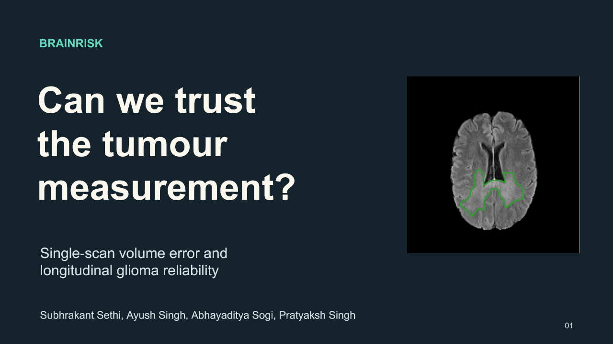

# BrainRisk

### Reliability of brain tumour MRI volume measurements

[](docs/presentation/BrainRisk.pptx)

**When should an automated tumour measurement receive human review?** This research project studies that question at two levels: volume error on one MRI scan, and progression calls across repeated scans.

Subhrakant Sethi, Ayush Singh, Abhayaditya Sogi and Pratyaksh Singh  
B.Tech Biotechnology, Thapar Institute of Engineering and Technology

[Evidence audit](docs/EVIDENCE_AUDIT.md) · [Reproduce](docs/REPRODUCING.md) · [Demonstration](demo/README.md) · [Presentation](docs/presentation/README.md) · [Research documents](docs/README.md)

## What we built

A standard MONAI residual 3D U-Net segments four MRI sequences into tumour core (TC), whole tumour (WT) and enhancing tumour (ET). Repeated dropout and flip-augmentation predictions provide reference-free uncertainty, disagreement and shape features. Lightweight quality-control models try to flag consequential volume errors without requiring a reference mask at inference.

We then studied serial glioblastoma scans in LUMIERE. Two existing tools, DeepBraTumIA and HD-GLIO-AUTO, produce enhancing-volume trajectories. A parameter-free agreement rule checks whether their volume-based progression calls match. Expert RANO labels let us evaluate how decision reliability differs between agreement and disagreement subsets.

**Status:** retrospective course-project research. The data support a useful comparison and a longitudinal agreement signal. They do not establish clinical safety or a new segmentation architecture.

## Results supported by saved artifacts

### BraTS 2023: consequence targeting did not improve QC

1,251 labelled cases, split into segmenter train **565**, segmenter validation **62**, risk development **379**, and risk test **245**. The training log records **59 epochs**, with best mean validation Dice **0.877** at epoch index 49 (WT **0.904**, TC **0.881**, ET **0.846**). These are validation scores.

The WT endpoint is relative volume error **>=25% AND absolute error >=1 mL**. It occurred in **23/245** test cases (9.4%). This research endpoint is distinct from a clinical RANO progression diagnosis.

| Method | Test AUROC | Bootstrap 95% CI |
|---|---:|---:|
| Best single uncertainty feature | 0.838 | 0.744–0.916 |
| Overlap-QC logistic baseline | 0.786 | 0.681–0.880 |
| Predicted volume alone | 0.766 | 0.666–0.855 |
| Consequence-targeted logistic model | 0.743 | 0.620–0.854 |

The consequence model's AUROC difference versus overlap-QC was **-0.043**, CI **[-0.121, 0.019]**, p=**0.248**. We did not detect a gain. This does not prove equivalence or establish that dedicated consequence models can never help.

The uncertainty baseline retained 137/245 cases (~56%) with 2/137 residual consequential errors (~1.5%) at the reported 90%-sensitivity point. **The evaluator chose that point using test labels; it is retrospective performance, not a frozen deployment threshold.**

Sources: [case features](results/brats2023/case_features.csv), [training log](results/brats2023/training_history.json), [comparison JSON](results/brats2023/optionB/flag_WT.json).

### LUMIERE: tool agreement identifies a more accurate subset

The source dataset contains 91 patients and 616 expert-rated timepoints. Our evaluable subset contains **221 decisions from 70 patients**.

| Automated call vs expert RANO | Balanced accuracy |
|---|---:|
| All eligible decisions | 0.608 |
| Tools agree | 0.693 |
| Tools disagree | 0.499 |

Agreement-minus-disagreement gap: **0.194**, patient-clustered bootstrap 95% CI **[0.045, 0.367]**. The gap was positive in **199/200** random patient splits (99.5%). On sizeable tumours the tools agreed on the direction of change in **57/114** consecutive intervals (50%). That is agreement between tools, not clinical diagnostic accuracy.

The agreement subset still had **34.7% raw decision error** on the full cohort. Agreement therefore supports research triage, not automatic clinical clearance. LUMIERE lacks manual masks, so this analysis cannot identify which tool measured the correct volume.

Sources: [robustness JSON](results/lumiere/strengthen.json), [third-voter JSON](results/lumiere/threeway.json), [source dataset](https://doi.org/10.1038/s41597-022-01881-7). Protocol implementation differences and the exploratory conformal results are documented in the [audit](docs/EVIDENCE_AUDIT.md).

## Contribution and novelty

Our contribution is the end-to-end implementation, consequence-labelled evaluation, honest negative comparison, and investigation of agreement at the **longitudinal decision** level. The longitudinal framing is the stronger research direction in this repository.

We reuse the U-Net architecture, Monte Carlo dropout, test-time augmentation, logistic regression and disagreement principles. We do not claim invention of these methods, clinical validation, or first-ever priority. Novelty is primarily in the study design and application, with limited evidence from a single longitudinal cohort. See [the evidence audit](docs/EVIDENCE_AUDIT.md) for related work and limitations.

## Demonstration without a GPU or dataset download

```bash
python demo/run_demo.py
python demo/run_demo.py --list
python demo/run_demo.py --patient Patient-002
```

The first command selects a real public-data trajectory containing a disagreement. It shows each tool's volume, running nadir, progression call and the agreement flag. It replays recorded measurements, not live MRI inference. Use `--list` for available IDs before selecting a patient.

## Repository layout

```text
src/brainrisk/       Core segmentation, features, metrics and risk models
scripts/pipeline/   Numbered training and evaluation commands
scripts/brats/      BraTS characterization and QC comparison
scripts/longitudinal/ LUMIERE analyses and shared helpers
scripts/data/       Acquisition helper
scripts/publication/ Figure and document generation
configs/            Dataset and experiment settings
results/            Versioned evidence snapshots
demo/               Offline real-data replay and provenance
docs/paper/         Manuscripts, protocols and original figures
docs/exports/       Historical PDF, Word and Overleaf exports
docs/research/      Literature notes and exploratory reports
docs/presentation/  Deck and presenter guide
tests/              Synthetic pipeline and demonstration checks
```

Large MRI datasets and model checkpoints are excluded. New experiment outputs go to `outputs/`; preserved evidence belongs in `results/`. Old paths are mapped in [REORGANIZATION.json](docs/REORGANIZATION.json).

## Training and reproduction

```bash
python -m venv .venv
# Activate the environment, then install an appropriate PyTorch build.
pip install -r requirements.txt
pip install -e .
pytest -q
python scripts/pipeline/00_make_splits.py --config configs/brats2023.yaml
python scripts/pipeline/01_train_segmentation.py --config configs/brats2023.yaml
```

Set the dataset root in the config first. Training uses 128-cubed patches, AdamW (learning rate 1e-4, weight decay 1e-5), Dice loss, dropout 0.1 and a cosine schedule. The config's 150-epoch budget is a planned maximum; the committed log records 59 epochs. See [full reproduction instructions](docs/REPRODUCING.md).

## Boundaries of the evidence

There is no external clinical validation. BraTS is cross-sectional; LUMIERE volume-only calls simplify expert RANO, which includes other imaging and clinical information. Repeated splits reuse one cohort. The exploratory conformal implementation does not establish a patient-level safety guarantee. Historical manuscripts contain older stronger claims; the root README and audit describe the defensible current interpretation.
