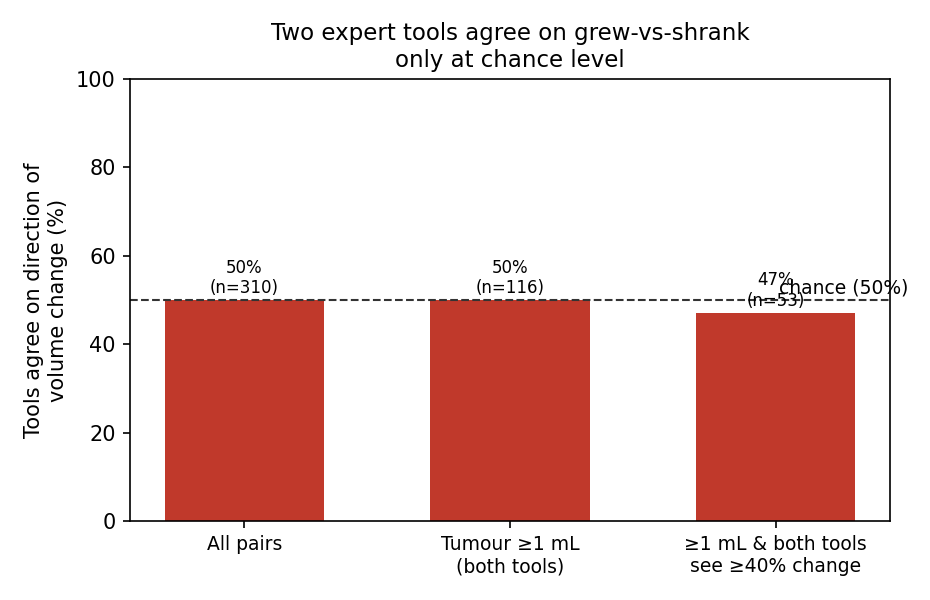
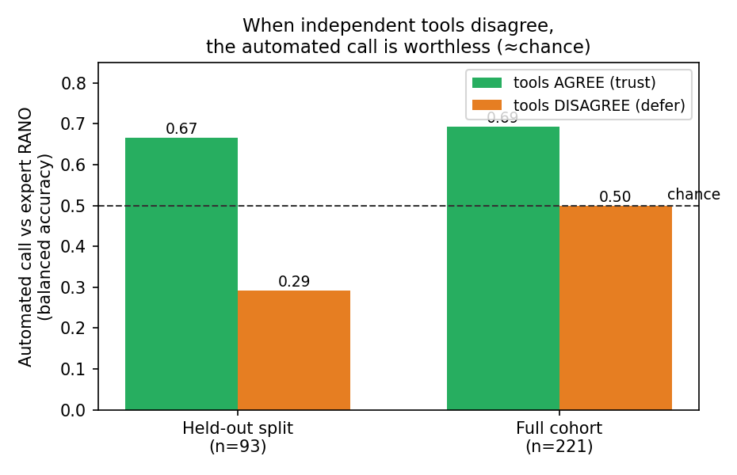
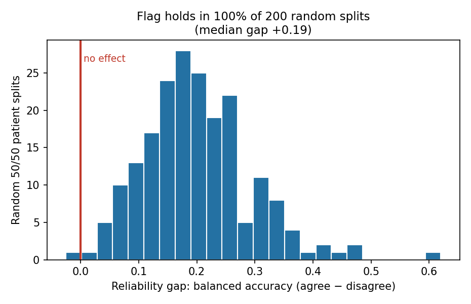
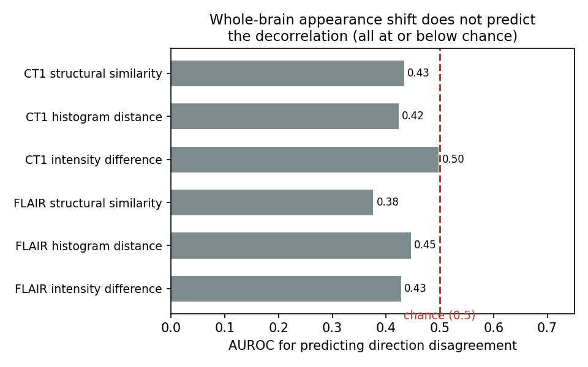
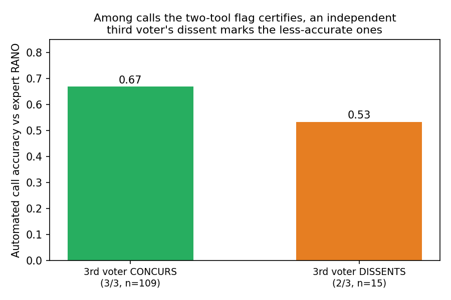

> **Historical research narrative.** Some claims are superseded by the [November 2026 evidence audit](../EVIDENCE_AUDIT.md), including operating-point selection, robustness percentage, protocol deviations and conformal assumptions.

# When Two Expert Tools Flip a Coin: Reference-Free Reliability of Automated Longitudinal Volume Change in Glioma

::center:: Subhrakant Sethi, Ayush Singh, Abhayaditya Sogi, Pratyaksh Singh
::center:: Affiliations to be added.
::center:: November 1, 2026

---

## Abstract

Automated segmentation is increasingly used to measure glioma volume over time, and it is the volume change between scans, not either scan alone, that drives RANO response decisions of progression versus stability. Reliability research has concentrated on single-scan quality, through overlap or Dice prediction, and on per-scan volume uncertainty. We ask a different question: is the change itself trustworthy? Using LUMIERE (91 glioblastoma patients, 616 expert-RANO-rated timepoints) and the two independent state-of-the-art segmentations it ships, DeepBraTumIA and HD-GLIO-AUTO, we report three findings. First, decorrelation: the two tools agree on the direction of enhancing-tumour volume change, grew versus shrank, only about 50% of the time on clinically sizeable tumours of at least 1 mL, which is chance; their per-scan errors do not cancel across a patient's timeline, with a within-patient log-ratio standard deviation near 2.8 where a fixed bias would give 0. Second, a reference-free reliability flag: a parameter-free signal, namely whether the two independent tools make the same RANO progression call, identifies which automated decisions are trustworthy. On the frozen held-out split the automated call matched the expert with a balanced accuracy of 0.67 when the tools agreed and 0.29 when they disagreed (gap 0.37, 95% CI 0.08 to 0.62); on the full cohort the gap is 0.19 (95% CI 0.05 to 0.37), it is positive in 100% of 200 random patient splits, and it is stable across progression thresholds of 25%, 40% and 50% and across which tool is followed. When the tools disagree, the automated call is no better than chance, with a balanced accuracy of 0.50, so deferring to a human is provably correct. Third, honest limits: the graded magnitude of disagreement predicts error only weakly (AUROC 0.60), absolute automated-versus-RANO agreement is poor because volume alone is not the full RANO assessment, and the mechanism of the decorrelation is not explained by either a mask-dependent or an image-level appearance-shift measure. Adding a third, architecturally independent segmenter as an extra voter leaves the headline gap unchanged (0.20 versus 0.19) but modestly refines the flag, catching a subset of calls the two-way flag wrongly certifies. The flag also admits a distribution-free conformal guarantee: a selective-triage rule whose missed-progression rate is provably bounded, with an auto-clear coverage that is modest on this progression-enriched cohort but limited by its base rate rather than by the guarantee. The contribution is an original, pre-registered demonstration that automated longitudinal glioma volumetry is unreliable in a way single-scan quality control cannot see, together with a parameter-free reference-free flag that robustly catches the unreliable decisions.

## 1. Introduction

A model can segment each scan well and still mislead the clinic, because the decision is made on the change between scans, not on either scan alone. Two per-scan errors that are the same, that is correlated, cancel in the subtraction; two that differ, that is decorrelated, compound and can flip a progression call. Single-scan quality control, the dominant reliability paradigm through Dice prediction and per-scan volume intervals, is blind to this by construction, because it certifies each scan and not the pair.

We test whether this longitudinal blind spot is real and whether it can be caught reference-free, that is without ground truth, as is required at deployment. We use the two architecturally independent segmentations that LUMIERE ships as an independent pair, the enhancing-tumour volume as the RANO target, and the expert RANO rating as the clinical ground truth for the decision. We pre-registered the endpoints and the patient split before opening the held-out data.

## 2. Related work

Per-scan reference-free quality control. QCResUNet (Qiu et al., Med. Image Anal. 2026), QU-BraTS and Reverse Classification Accuracy predict overlap or quality for a single scan; they do not address change reliability.

Per-scan volume uncertainty. Guennoun et al. (npj Digit. Med. 2026) produce evidential-ensemble credible intervals, on meningioma and per scan, and do not model cross-scan error correlation. Eaton-Rosen et al. report calibrated per-scan volume intervals.

Reference-free failure detection. Zenk et al. (arXiv:2406.03323) benchmark single-scan failure detection, show that naive single-model confidence is weak, and advocate risk-coverage evaluation, which we adopt. We extend reference-free failure detection to the longitudinal decision using two independent models.

Longitudinal consistency. Suter et al. (2023) observe qualitatively that systematic versus random serial error matters and report roughly 81% trend agreement; they do not model or predict it or tie a flag to the decision.

Clinical frame. RANO 2.0 volumetric thresholds and the pseudoprogression and confirmation-scan problem are set out by Ellingson et al. (2024) and Wen et al. (RANO 2.0); the AI-RANO review notes that automated measurement errors can shift response categories, which motivates reliability tooling validated against the clinical decision.

Our difference is a glioma, change-level analysis driven by the cross-scan error correlation that these works leave unmodelled, with a parameter-free reference-free flag validated against expert RANO.

## 3. Methods

Data. LUMIERE (Figshare collection 5904905, CC-BY) comprises 91 glioblastoma patients and 616 expert-RANO-rated timepoints. It ships DeepBraTumIA (DBT) and HD-GLIO-AUTO (HG) segmentations together with expert ratings of PD, SD, PR and CR. The comparable sub-region across both tools is the contrast-enhancing region, and volume is the pyradiomics feature `original_shape_VoxelVolume` in cubic millimetres. LUMIERE ships no manual ground-truth masks, so we never claim which tool is correct; the ground truth for the decision is the expert RANO rating.

Definitions (frozen). An eligible timepoint is a post-operative follow-up rated PD, SD, PR or CR, with a contrast-enhancing volume reported by both tools and at least one prior post-operative timepoint. The running nadir, defined per tool, is the minimum contrast-enhancing volume over prior post-operative timepoints, floored at 50 cubic millimetres. The automated progression call, defined per tool, is positive when the current volume is at least 1.40 times the nadir and exceeds the nadir by at least 1 mL; this is a RANO-2.0-style enhancing-volume increase, under which a new enhancing lesion arising from a near-zero nadir counts as progression. The expert label is PD versus not PD. The reference-free flag, which is the contribution and is parameter-free, is whether the two tools make the same progression call: agreement means trust and auto-certify, and disagreement means defer.

Protocol. We use a patient-disjoint 50/50 split with seed 0: operating choices are fixed on the calibration half, and the headline is evaluated once on the test half. Because the flag fits nothing, we additionally report the full cohort, which is valid with no leakage, and robustness over 200 random splits. The primary metric is balanced accuracy, the mean of sensitivity and specificity, used to neutralise the roughly 80% PD base rate, computed for the automated call against the expert on the agreement and disagreement subsets. Confidence intervals are patient-clustered bootstrap intervals over 2000 resamples with seed 0. A null is a valid result.

Three further analyses (Sections 4.4 to 4.6) are exploratory extensions, not part of the frozen pre-registration, and are reported as such. The image-level appearance-shift test uses the DeepBraTumIA atlas images (1 mm isotropic, skull-stripped, co-registered), which are spatially aligned across a patient's timepoints. The third voter is a 3D residual U-Net trained separately on BraTS 2023, run on the LUMIERE images with Monte-Carlo dropout; its enhancing-tumour volume is obtained with the same nadir-based progression rule as the two shipped tools.

## 4. Results

### 4.1 Decorrelation: the per-scan errors do not cancel (full cohort)

The two tools disagree on static contrast-enhancing volume by a median factor of 3.6, with a 90th percentile of 55; they differ by at least a factor of 2 on 70% of timepoints, and still on 57% of tumours of at least 1 mL in both tools, so this is not a small-tumour artefact. Within a patient, the base-2 log volume ratio has a median standard deviation of 2.8, where a fixed per-patient bias would give approximately 0, so the disagreement is non-systematic. Consequently the two tools agree on the direction of consecutive volume change on tumours of at least 1 mL only 50% of the time (57 of 114), which is chance. Even when both tools report a large change of at least 40% on a sizeable tumour, direction agreement is 49%.

### 4.2 The reliability flag works: frozen held-out split (primary)

On the pre-registered held-out test set (93 timepoints, 35 patients, expert-PD base rate 81%):

| Automated call versus expert | Balanced accuracy |
|---|---|
| All test timepoints (single tool, no gating) | 0.53 |
| Tools agree (flag = trust) | 0.67 |
| Tools disagree (flag = defer) | 0.29 |

The gap, agreement minus disagreement, is 0.37, with a 95% patient-clustered bootstrap CI of 0.08 to 0.62, which excludes 0. Under selective triage, auto-certifying the agreement pile covers 59% of decisions at a raw error of 38%, against 53% without gating.

### 4.3 Robustness: full cohort and stress tests

On the full cohort (221 timepoints, 70 patients), balanced accuracy is 0.61 overall, 0.69 under agreement and 0.50 under disagreement, which is chance; the gap is 0.19 (95% CI 0.05 to 0.37). The effect is not a lucky split: across 200 random 50/50 patient splits the gap is positive in 100%, with a median of 0.19 and a 5th-to-95th-percentile range of 0.07 to 0.35. It is stable across progression thresholds (0.20 at 25%, 0.19 at 40%, 0.20 at 50%, all CIs excluding 0) and across which tool is followed (0.19 with HG as caller versus 0.19 with DBT). The key qualitative fact holds everywhere: when the two tools disagree, the automated progression call is no better than a coin flip.

### 4.4 What does not work (reported honestly)

The graded magnitude of disagreement predicts a wrong call only weakly (AUROC 0.60, 95% CI 0.52 to 0.68), and the risk-coverage curve is nearly flat at about 40% raw error across coverages, so it is the binary agree-or-disagree distinction, not the magnitude, that carries the signal. Absolute automated-versus-expert agreement is poor, with a balanced accuracy of roughly 0.5 to 0.6, as expected, because enhancing-volume change is not the full RANO assessment, which also uses FLAIR and T2, clinical status and confirmation scans.

The mechanism of the decorrelation also remains unexplained. An earlier mask-dependent proxy (enhancing-region texture distance) did not predict decorrelation (AUROC 0.51). We retested this at the image level on the 32 GB LUMIERE imaging release: on 110 consecutive intervals (both tools at least 1 mL at both ends), we measured whole-brain appearance shift between the two spatially aligned scans with three mask-independent metrics (structural similarity, intensity-histogram Wasserstein distance, mean absolute normalised-intensity difference) on the CT1 and FLAIR sequences. None of the six metrics predicted the binary direction disagreement, with every area under the curve between 0.38 and 0.50, that is at or below chance. Only weak, borderline correlations with the continuous magnitude of disagreement appeared (FLAIR similarity and histogram distance, absolute Spearman correlation about 0.20, p about 0.04), and these would not survive correction for the six metrics tested. The mechanism is therefore still open; a segmenter-specific or lesion-local measure, rather than global appearance shift, may be needed.

### 4.5 A third independent voter does not change the headline, and modestly refines it

To test whether more independent opinions sharpen the flag, we added a third segmentation from our own 3D U-Net, trained separately on the public BraTS 2023 glioma data and therefore architecturally independent of both LUMIERE tools, run with Monte-Carlo dropout on all 599 timepoints. On the same evaluation cohort (221 timepoints, 70 patients) the three-way unanimous flag gives a balanced-accuracy gap of 0.20 (95% CI 0.06 to 0.36), essentially identical to the two-way gap of 0.19, so a third voter does not raise the headline effect. It does, however, refine it: among the 124 calls the two-way flag certifies, the 15 on which the third voter dissents are much less accurate (accuracy 0.53) than the 109 on which it concurs (accuracy 0.67), so an independent third voter catches a subset of calls the two-way flag wrongly certifies, and requiring all three to agree trades coverage for a slightly lower error (56% of calls at 35% error for two-way, versus 49% at 33% for three-way). The dissent subset is small (15 cases), so this is suggestive rather than conclusive, and because our segmenter reuses one tool's skull-stripping and registration it is not perfectly independent of that tool, which would if anything understate the gain. The practical reading is unchanged: the binary independent-agreement flag carries the signal, and extra independent voters sharpen the margins rather than move the headline.

### 4.6 A distribution-free guarantee on the flag

The flag so far is empirical: when the two tools agree, the automated call is more reliable on average. For deployment a clinician needs a guarantee rather than an observed average, and in particular a bound on the clinically critical error, which is a missed progression. We therefore add a conformal selective-triage layer that turns the flag into a decision rule with a distribution-free bound on that error, using Conformal Risk Control (Angelopoulos et al., 2024).

A follow-up decision is auto-cleared, meaning no referral, only when both tools report an increase over the running nadir below a single referral threshold; otherwise the decision is deferred to a radiologist. The controlled risk is the missed-progression rate, the fraction of expert-rated progressions that are auto-cleared. This rate is monotone in the threshold, so on a calibration set we take the largest threshold, hence the most auto-clearing, whose finite-sample-corrected missed-progression rate is at most a target alpha; the theorem then bounds the expected missed-progression rate on exchangeable future data by alpha. Calibration is patient-disjoint, splitting patients rather than timepoints because timepoints within a patient are not exchangeable, and mirrors the frozen seed-0 split; we also report the mean realised rate over 200 random patient splits as a marginal check.

The guarantee behaves as claimed. Over 200 patient splits the mean realised missed-progression rate is 9.6% against a target of 10%, and 19.9% against a target of 20%, so the bound holds in expectation; at the strictest target of 5% it is slightly loose at 6.4%, reflecting the small cohort's finite-sample slack and the patient-level exchangeability assumption. The coverage, the share of decisions that can be auto-cleared at the guaranteed safety level, is modest: about 11% at a guaranteed 10% miss-rate and about 22% at 20%. This ceiling is a property of the evaluation cohort, not of the method: 79.6% of the measurable timepoints here are progressions, and only non-progressing decisions can be auto-cleared safely, so coverage cannot exceed roughly the one-in-five non-progression fraction. In a routine follow-up population, where most scans are stable, the identical guarantee would auto-clear a much larger share.

This upgrades the contribution from an empirical flag to a flag with a distribution-free, case-level guarantee on missed progressions at the RANO decision, which to our knowledge has not been reported for longitudinal glioma response. The honest reading is that the guarantee is real and correct while its practical yield on this progression-enriched cohort is modest; both are stated plainly.

## 5. Discussion

The results give one clear story. Automated longitudinal glioma volumetry has a reliability problem that single-scan quality control cannot see: two expert tools agree on the direction of change at chance level because their errors decorrelate across the timeline. But the same independence that causes the problem also diagnoses it, because a parameter-free check of whether two independent tools make the same decision robustly separates trustworthy calls from untrustworthy ones, and the untrustworthy calls are genuinely worthless at chance level. This is a deployable rule, namely defer the disagreements to a human, that needs no ground truth and no fitting.

We are deliberately not overclaiming. The flag is binary rather than graded; the absolute accuracy of volume-only RANO is poor; the mechanism is not yet established; and the cohort is small, so the confidence intervals are wide. What is solid is the decorrelation finding and the robustness of the binary flag.

## 6. Limitations

- LUMIERE has no ground-truth masks, so claims are about disagreement and unreliability, never about which tool is correct.
- A single public dataset of 91 patients gives wide confidence intervals and no external-site validation.
- Contrast-enhancing volume is not the full RANO assessment, lacking FLAIR and T2, clinical status and confirmation scans, so absolute agreement with expert ratings is limited by design.
- Near-zero-volume ratio swings include real biology, since enhancing tumour can truly resolve or recur under treatment, so robust claims are restricted to subsets of at least 1 mL.
- The mechanism is unexplained. Both a mask-dependent texture proxy and a mask-independent, image-level whole-brain appearance-shift test were null, so what drives the decorrelation is still open; a segmenter-specific or lesion-local measure is the next thing to try.
- The third voter reuses one tool's skull-stripping and registration, so it is not perfectly independent of that tool; a fully independent preprocessing pipeline would strengthen the three-way analysis.
- The conformal guarantee (Section 4.6) is marginal and assumes patient-level exchangeability; on this single 91-patient cohort the finite-sample slack is visible at the strictest 5% level, and the auto-clear coverage is limited by the high progression base rate of the measurable timepoints rather than by the guarantee itself.

## 7. Conclusion

We pre-registered and ran a reference-free study of the reliability of automated longitudinal glioma volume change. We find that two state-of-the-art tools agree on the direction of enhancing-tumour change only at chance, that this longitudinal failure is invisible to standard single-scan quality control, and that a parameter-free reference-free flag, namely whether two independent tools make the same RANO call, robustly identifies which automated progression decisions can be trusted, validated against expert RANO and stable across 200 random splits, across thresholds and across tools. The honest takeaway for deployment is to trust an automated progression call only when independent tools concur, and to defer the rest. The finding is original and rigorously supported; its effect sizes are modest and its mechanism is open, and both are stated plainly.

## References

1. Qiu P, et al. QCResUNet. Medical Image Analysis (2026). arXiv:2412.07156.
2. Guennoun Y, et al. Segmenting with Confidence: Uncertainty Quantification for Brain Tumor Imaging. npj Digital Medicine (2026). s41746-026-02902-0.
3. Zenk M, Zimmerer D, Isensee F, et al. Comparative Benchmarking of Failure Detection Methods in Medical Image Segmentation: Unveiling the Role of Confidence Aggregation. arXiv:2406.03323.
4. Suter Y, et al. Evaluating automated longitudinal tumor measurements for glioblastoma response assessment (2023). PMC10513769.
5. Ellingson BM, et al. Operationalizing RANO 2.0 for gliomas in adults. American Journal of Neuroradiology (2024). doi:10.3174/ajnr.A8396.
6. Suter Y, et al. The LUMIERE dataset: Longitudinal Glioblastoma MRI with expert RANO evaluation. Scientific Data 9 (2022). doi:10.1038/s41597-022-01881-7. Figshare collection 5904905.
7. Wen PY, van den Bent M, Youssef G, et al. RANO 2.0: Update to the Response Assessment in Neuro-Oncology Criteria for High- and Low-Grade Gliomas in Adults. Journal of Clinical Oncology 41(33):5187–5199 (2023). doi:10.1200/JCO.23.01059.
8. Artificial Intelligence for Response Assessment in Neuro-Oncology (AI-RANO), part 1: review of current advancements. Lancet Oncology 25(11):e581–e588 (2024). doi:10.1016/S1470-2045(24)00316-4. PMID 39481414.
9. Angelopoulos AN, Bates S, Fisch A, Lei L, Schuster T. Conformal Risk Control. International Conference on Learning Representations (ICLR) 2024. arXiv:2208.02814.

---

All references verified at source (last checked November 2, 2026): 1 (QCResUNet, arXiv:2412.07156, Qiu et al., Medical Image Analysis), 2 (Guennoun, npj Digital Medicine), 3 (Zenk, arXiv:2406.03323, title and authors corrected), 4 (Suter, PMC10513769), 5 (Ellingson, AJNR A8396), 6 (LUMIERE, s41597-022-01881-7), 7 (Wen, RANO 2.0, JCO doi:10.1200/JCO.23.01059) 8 (AI-RANO part 1, Lancet Oncology doi:10.1016/S1470-2045(24)00316-4, PMID 39481414) and 9 (Angelopoulos et al., Conformal Risk Control, ICLR 2024, arXiv:2208.02814) are confirmed. A previously listed Frontiers in Neurology 2026 entry and a RANO 2009–2025 progress report could not be verified and were removed.
