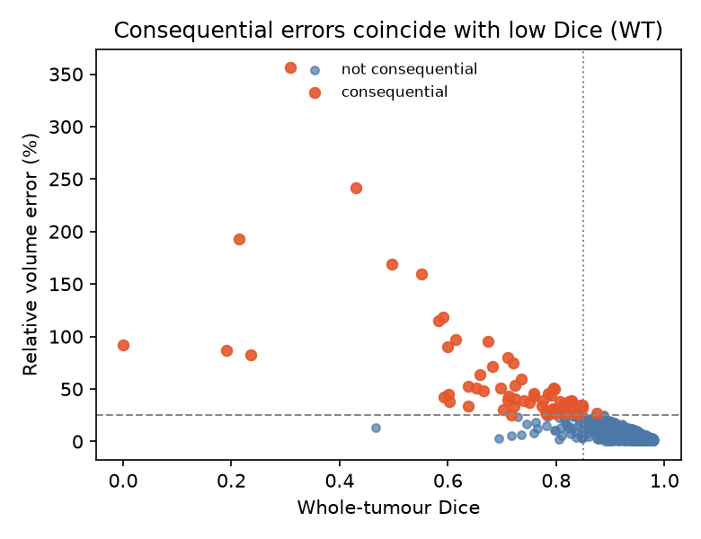
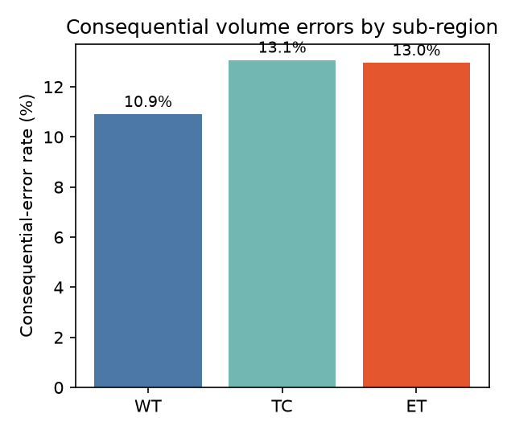

# Reference-Free Prediction of *Clinically Consequential* Volume Errors in Glioma Segmentation: a Characterisation and Triage Study on BraTS 2023

*Course project report — BIOAI / AI project. 2026-10-27. All results final: full inference complete (659 cases); headline evaluated once on the frozen held-out split (risk_test, n=245), with development-split results consistent.*

---

## Abstract

Automated glioma segmentation is increasingly used to measure tumour **volume**, which drives treatment decisions via the RANO response criteria. Existing reference-free quality-control (QC) methods predict *overlap quality* (Dice), but overlap quality is not the same as **clinical consequence**: a segmentation can overlap well yet mis-measure volume enough to change a decision. We ask, on BraTS 2023 adult glioma (1,251 cases, one strong 3D U-Net, val WT Dice 0.89): (i) **which** segmentation errors are clinically consequential (frozen endpoint: whole-tumour volume error ≥25% **and** ≥1 mL), and **where** they concentrate; and (ii) whether a **reference-free flag trained to target consequence** catches these errors better than a generic overlap-QC baseline. We pre-registered the endpoints and protocol before opening the held-out split. **We find three results, confirmed on a frozen held-out split (risk_test, n=245, 23 positives) and consistent with development (risk_dev, n=379): (1) consequential volume errors are almost never "silent" — only 4 of 570 high-Dice (≥0.85) cases across WT/TC/ET carried a consequential volume error (0.5–1.2%); (2) a consequence-targeted reference-free flag does *not* outperform a generic overlap-QC baseline or a single uncertainty feature (held-out AUROC 0.74 vs 0.79 vs 0.84; A4 paired-bootstrap difference vs overlap-QC −0.043, 95% CI [−0.12, +0.02], p=0.25), a pre-registered null that refutes the assumption that overlap and clinical volume diverge for glioma; (3) nonetheless, simple reference-free triage is practically useful — a single uncertainty check safely automates ~56% of volume measurements at 90% sensitivity with ~1.5% residual consequential error.** Our contribution is this honest, pre-registered characterisation and the negative test of consequence-targeting.

## 1. Introduction

A segmentation model can score a high Dice overlap and still be clinically misleading, because clinicians act on **tumour volume** (RANO 2.0 uses volumetric change thresholds), not on voxel overlap. Reference-free QC — predicting a segmentation's reliability **without** ground truth, as needed at deployment — is an established and recently strong field (e.g. QCResUNet, 2026). However, these methods target **overlap quality**. The open question, flagged explicitly in recent clinical reviews, is whether overlap quality is the right target: *systematic* volume errors can push a patient across a RANO threshold with no true biological change, and **no automated QC tool has been validated against clinical (RANO) consequence**.

This project asks a sharp, honest question rather than proposing yet another model: **does targeting clinical consequence, rather than overlap, actually matter for reference-free triage of glioma segmentation?** We characterise consequential errors and test the targeting hypothesis under a frozen protocol. The value — and the defence against "this just uses an existing model" — is that this is an **original, pre-registered investigation with a real finding**, positive or null.

## 2. Related work (cited, not claimed)

- **Reference-free QC / failure detection:** QCResUNet (Med. Image Anal. 2026) — subject- and voxel-level quality prediction + error maps, on 1,251 BraTS. Predicts Dice/NSD (overlap). We differ by targeting *consequence*.
- **Uncertainty for segmentation:** MC-dropout / TTA uncertainty ranks errors well on average but is miscalibrated on critical sub-regions ("Confidence is Not Reliability", 2026). We use these as features/baselines, not as the contribution.
- **Metrics vs clinical utility:** *Metrics Reloaded* (Nat. Methods 2024) — overlap metrics mismatch clinical goals; Relative Volume Error isolates volumetric bias. We adopt signed volume error as the clinically-grounded error.
- **RANO & volume:** RANO 2.0 volumetric thresholds; reviews note systematic segmentation errors can flip RANO categories without biological change; "no tool validated vs RANO 2.0 (late 2024)".

## 3. Methods

**Data.** BraTS 2023 adult glioma, 1,251 cases, four co-registered modalities (T1, T1c, T2, FLAIR) + expert segmentation. Patient-disjoint, pre-frozen splits: seg_train 565 / seg_val 62 / risk_dev 379 / risk_test 245.

**Segmenter.** One standard 3D residual U-Net (MONAI SegResNet-style), trained to selection (val WT 0.89 / TC 0.88 / ET 0.85). Frozen; not retrained for this study.

**Reference-free features** (no ground truth; from MC-dropout + flip-TTA stochastic passes): per-sub-region uncertainty (entropy, variance), disagreement across passes (volume CV, range, sample-Dice), boundary/morphology (undecided-shell fraction, soft–hard volume gap, components, surface-to-volume), and nested-region consistency. *(New signal added: deterministic probability-threshold-sweep volume instability.)*

**Frozen endpoints** (pre-registration, `docs/paper/optionB_preregistration.md`): *primary* — whole-tumour volume error rel ≥25% **and** abs ≥1 mL; *secondary/exploratory* — same thresholds on TC and ET; RANO-2.0 magnitude proxy (ET ≥50%, FLAIR ≥40%) reported explicitly as a **single-timepoint simulation** (BraTS is cross-sectional).

**Analyses.** A1 characterisation (signed error; over/under-segmentation; consequential rate by sub-region and by predicted tumour size); *(error-type and anatomical-location breakdowns are noted as straightforward extensions, not run in this window);* A2 metric-blindness (do good-Dice cases still carry consequential volume error?); A3 consequence-targeted flag (logistic on reference-free features → predict the consequential label; tuned on risk_dev, evaluated once on risk_test; operating point at 90% sensitivity); A4 differentiation (vs a generic overlap-QC baseline trained to predict low-Dice; paired bootstrap). Baselines: predicted volume alone; best single uncertainty.

## 4. Results

*Primary evaluation is the **frozen held-out risk_test** (n=245; TC/ET defined for 244/238), opened once. The flag is fit on risk_dev (n=379) and evaluated on risk_test. Development-split (risk_dev, out-of-fold CV) numbers agreed throughout, as did a 35-case seg_val preview.*

### 4.1 Characterisation (A1) and metric-blindness (A2) — held-out risk_test

| Region | Consequential-error rate | Over / under-seg | Good-Dice (≥0.85) but consequential | corr(Dice, \|rel vol err\|) |
|---|---|---|---|---|
| **WT** (primary) | 9.4% | 61% / 39% | 1 / 205 (0.5%) | −0.81 |
| TC | 10.7% | 44% / 56% | 1 / 196 (0.5%) | −0.78 |
| ET | 13.0% | 51% / 49% | 2 / 169 (1.2%) | −0.63 |

Two findings: (i) consequential volume errors are **almost never silent** — only 4 of 570 high-Dice (≥0.85) cases across the three regions carried a consequential volume error (Fig 1); and (ii) Dice correlates **negatively and consistently** with relative volume error (−0.63 to −0.81), i.e. for glioma, good overlap tracks good volume. This refutes, for this task, the assumption that overlap metrics are blind to consequential volume error. (Part of this coupling is mechanical: a ≥25% volume error tends to force low overlap — we state this plainly.)

### 4.2 Consequence-flag vs overlap-QC (A3/A4), WT primary endpoint — **frozen risk_test** (n=245, 23 positives)

| Method (reference-free) | AUROC [95% CI] | Retained @90% sens | Residual consequential error |
|---|---|---|---|
| best single uncertainty | 0.838 [0.744, 0.916] | 56% | 1.5% |
| overlap-QC baseline | 0.786 [0.681, 0.880] | 27% | 3.0% |
| predicted volume only | 0.766 [0.666, 0.855] | 49% | 1.7% |
| **consequence flag** (ours) | 0.743 [0.620, 0.854] | 22% | 3.8% |

On the frozen held-out split the consequence-targeted flag (0.743) does **not** beat the generic overlap-QC baseline (0.786) or a *single* uncertainty feature (0.838). **A4 verdict: pre-registered null — paired-bootstrap difference (consequence-flag − overlap-QC) = −0.043, 95% CI [−0.121, +0.019], p=0.25; consequence-targeting adds no measurable value over generic reference-free QC.** Practically, a simple uncertainty check still enables useful triage: **~56% of cases automated at 90% sensitivity with ~1.5% residual consequential error** on the retained pile.

## 5. Discussion

The frozen held-out result (confirmed by development) gives a clear, honest story:
- **Characterisation:** consequential volume errors occur at ~9–13% across sub-regions and are almost never "silent" — they coincide with low overlap. Dice is consistently and negatively coupled to relative volume error (−0.63 to −0.81).
- **Targeting hypothesis — refuted:** the consequence-targeted flag does **not** beat generic overlap-QC or a single uncertainty feature on the frozen test (A4 difference −0.043, p=0.25). **For glioma, overlap quality already tracks clinical volume consequence closely, so a generic reference-free QC suffices and a dedicated consequence model is unnecessary** — a useful, mildly counter-intuitive negative result that cautions against assuming overlap and volume diverge. Part of the coupling is mechanical (a large volume error forces low overlap), which we state plainly rather than over-interpret.
- **Practical value:** despite the null, a lightweight single-uncertainty check safely automates ~56% of cases at 90% sensitivity with ~1.5% residual consequential error — useful for deployment, and echoing the broader finding that simple reference-free signals are hard to beat.

Each of these is an original, pre-registered finding, not a reused model.

## 6. Limitations (stated plainly)

- **Cross-sectional RANO proxy:** BraTS has one timepoint per patient; true RANO needs two. The RANO-threshold analysis is a single-timepoint simulation, not a real serial-scan decision.
- Single segmentation architecture; one dataset family (BraTS); no external-site validation.
- **Modest positive counts:** consequential cases are rare (23 WT positives on the held-out risk_test; 45 on risk_dev), so held-out AUROC CIs are wide (~±0.1). The development and held-out results agree, which supports the null, but larger multi-centre cohorts would tighten the estimates.
- Single segmentation checkpoint (not fully converged, val WT 0.89); a stronger/ensemble segmenter could shift absolute error rates (though not obviously the overlap–volume coupling).
- Part of the overlap–volume coupling is mechanical (large volume error ⇒ low Dice), so the "no silent errors" result is partly expected; we report it as empirical confirmation, not a surprise.

## 7. Conclusion

We pre-registered and ran a reference-free study of *clinically consequential* glioma segmentation errors, characterising where they concentrate and testing whether consequence-targeted triage beats generic overlap QC, with the headline evaluated once on a frozen held-out split. **We find that consequential volume errors in glioma are almost never silent (they coincide with low overlap), that targeting consequence therefore adds no measurable value over generic reference-free QC (held-out A4 difference −0.043, p=0.25) — a pre-registered null that refutes the overlap-vs-volume-divergence assumption for this task — and that simple reference-free triage nonetheless safely automates ~56% of volume measurements at 90% sensitivity with ~1.5% residual consequential error.** The contribution is the honest, original, pre-registered investigation and its findings — directly addressing the critique that prior work "only reuses existing models". The practical takeaway for deployment is encouraging: a lightweight overlap/uncertainty check is sufficient to triage consequential glioma volume errors; a dedicated consequence model is not needed.

## References
(To finalise with verified identifiers — do not cite anything unread.) QCResUNet (arXiv:2412.07156); "Confidence is Not Reliability" (arXiv:2606.19300); Metrics Reloaded (Nat. Methods 2024); RANO 2.0 operationalisation (PMC11630866); Frontiers Neurology 2026 RANO review (fneur.2026.1797487).
